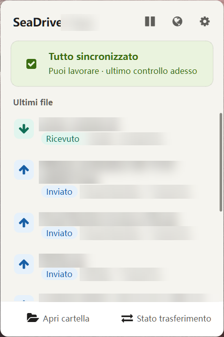

# seadrive-gui — UI redesign (fork)

A fork of [haiwen/seadrive-gui](https://github.com/haiwen/seadrive-gui), the desktop client of SeaDrive.
Branch: `redesign-ui`. Based on upstream `master` at version 3.0.27.

This fork changes only the interface. The sync engine (`seadrive.exe`) is the official one and is not touched.

> Unofficial. Not affiliated with or endorsed by Seafile Ltd.

## Why

I use SeaDrive every day with my own Seafile server. It works well. The interface felt old next to other sync clients:
small dialogs, little feedback on what is syncing, errors that are hard to read.

So I rebuilt the main screens in a flat, minimal style, close to what people know from OneDrive.
Same features, clearer layout.

## Before / After

| Screen | Before | After |
|---|---|---|
| Tray panel | — (left click only opened the folder) | `after-tray.png` |
| Tray panel, dark theme | — | `after-tray-dark.png` |
| Tray panel, paused | — | `after-tray-paused.png` |
| Account selector (2+ accounts) | — | `after-account-selector.png` |
| Transfer status | `before-transfer.png` | `after-transfer.png` |
| Transfer status, errors | `before-errors.png` | `after-errors.png` |
| Settings, General | `before-settings.png` | `after-settings-general.png` |
| Settings, Cache | — | `after-settings-cache.png` |
| Context menu (tray icon) | `before-menu.png` | `after-menu.png` |

## Features

### Tray panel (new)
- Sync status at the top: in progress, all synced, paused, errors.
- Recent files with direction: **Sent** (local change uploaded) or **Received** (remote change downloaded).
- Buttons: Open folder, Transfer status, Open online (globe), Settings.
- Pause sync: 30 min, 2 h, 8 h, or until resumed. The pause survives a daemon restart.
- Account selector when you have two accounts or more.

### Transfer status window (new)
- One window for transfers and errors. Replaces the old progress and sync-errors dialogs.
- Filter pills, search box.
- Readable error messages, with a link to open the folder.

### Settings window (new)
- Sidebar: General, Sync, Cache, Accounts, Encrypted Libraries, Network and proxy, Logs and diagnostics, About.
- Toggle switches. Changes are saved right away.
- Light, dark or system theme.
- New **Cache** page: space used (bar), size limit, automatic cleanup.

### Other
- Modern context menus.
- Shared design tokens (`src/ui/design-tokens.h`) for colors and sizes, light and dark.
- All new text goes through `tr()`. Existing upstream strings are reused where the meaning is the same, so the 29 existing translations keep working. New strings: Italian is complete, other languages fall back to English.
- Fix: "Open folder" for errors without a library, and for paths with spaces.
- Settings window opens in about 0.1 s (prepared in the background after startup).

## What I did not add

There is no "Sync now" button. The daemon is closed source and has no RPC to force a sync.
A button that does nothing would be dishonest, so it is not there.

## Build on Windows

Upstream ships `seadrive-gui.sln` / `seadrive-gui.vcxproj` (updated in this branch with the new files)
and a `CMakeLists.txt` (also updated). The upstream README only documents the Linux build.

What I used:

| Part | Version |
|---|---|
| Qt | 6.10.3, `msvc2022_64`, with Qt WebEngine and Core5Compat (installed with aqtinstall) |
| Compiler | Visual Studio 2022 Build Tools, x64 |
| Dependencies | vcpkg, manifest `vcpkg.json` (glib, jansson, openssl, pthreads, getopt, sqlite3), triplet `x64-windows` |
| libsearpc | [haiwen/libsearpc](https://github.com/haiwen/libsearpc), built as a static library |
| Generator | CMake + Ninja |

Steps:

1. Install Qt 6.10 (msvc2022_64 + WebEngine) and VS 2022 Build Tools.
2. Install the dependencies with vcpkg from the repo root: `vcpkg install --triplet x64-windows`.
3. Clone libsearpc next to this repo.
4. Build. TODO: I built with a small external CMake file that mirrors `seadrive-gui.vcxproj` (Release|x64) and also compiles libsearpc and the `.qm` translations. I still need to check whether the repo `CMakeLists.txt` or the `.sln` builds on Windows without it, and document the exact commands.
5. Compile translations: `lrelease i18n/*.ts` (the `.qm` files are in `.gitignore` and are required by `seadrive-gui.qrc`).
6. Deploy Qt next to the exe: `windeployqt seadrive-gui.exe`.
7. Put `seadrive.exe` (the daemon) next to `seadrive-gui.exe`. You can take it from the official SeaDrive installer; I tested with daemon 3.0.26.

Qt 6.5 or later is required (the theme uses `QStyleHints::colorScheme()`).

## Known limits

- Tested on Windows 11 only. macOS and Linux: not tested.
- No "Sync now" (see above).
- Cache space is read from the daemon's `cache.db` (read only). If the file is missing or locked, the page shows a dash.
- The daemon has no switch to turn off cache cleanup. "Off" sets a 30-day interval.
- New strings are translated only in Italian.
- The "Start with Windows" option has an extra path for my personal launcher script (`avvia-seadrive-franz.vbs`). Without that file it behaves like upstream. TODO: remove or make generic before any upstream PR.

## License

Apache License 2.0, same as upstream. See [LICENSE](LICENSE).

## Credits

- [Seafile / haiwen](https://github.com/haiwen) for Seafile, SeaDrive and the original `seadrive-gui`.
- The translators of the upstream project on [Transifex](https://explore.transifex.com/haiwen/seadrive-gui/).
- [QtAwesome](https://github.com/gamecreature/QtAwesome), already bundled upstream.

Redesign by Francesco Granzini ([@FranzGra](https://github.com/FranzGra)).
